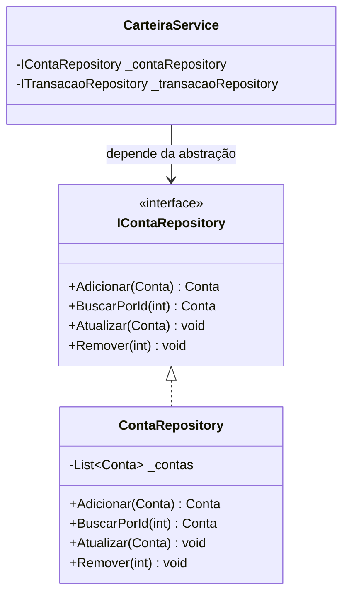
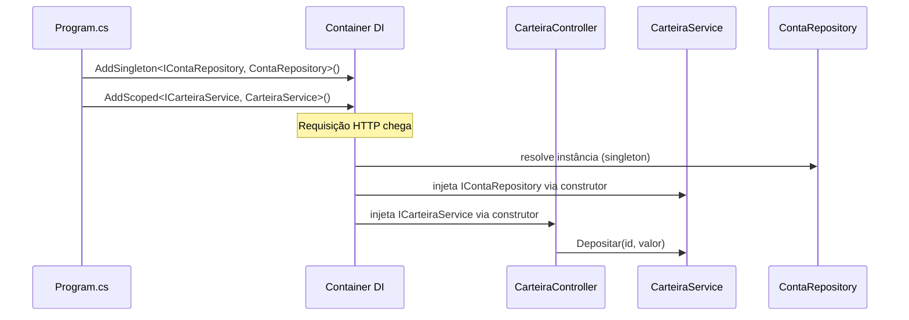
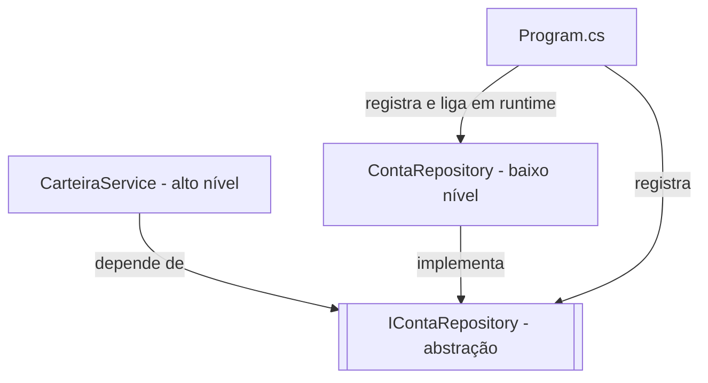
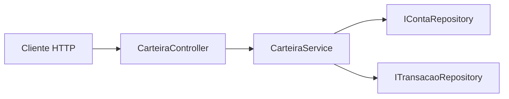
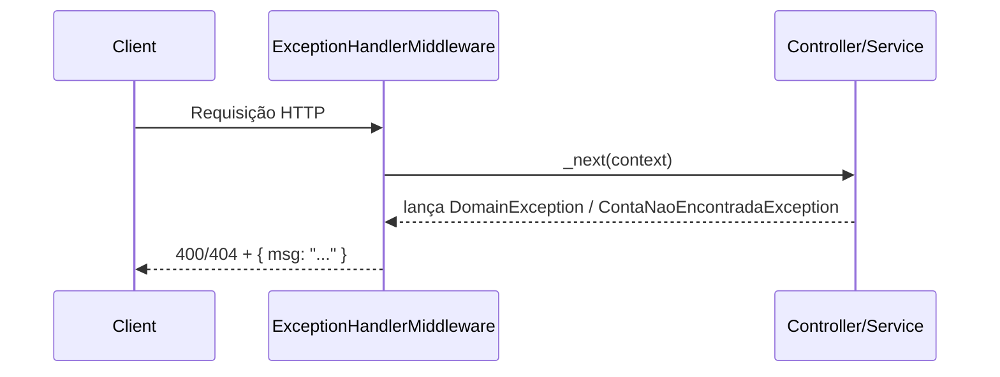
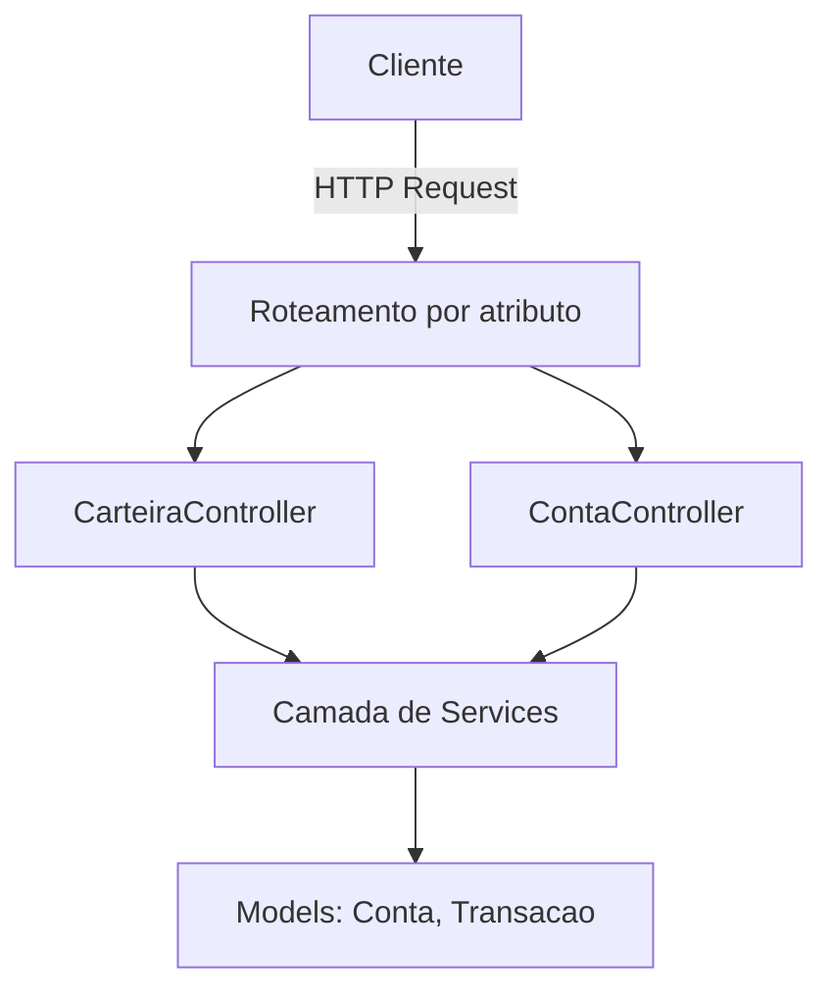
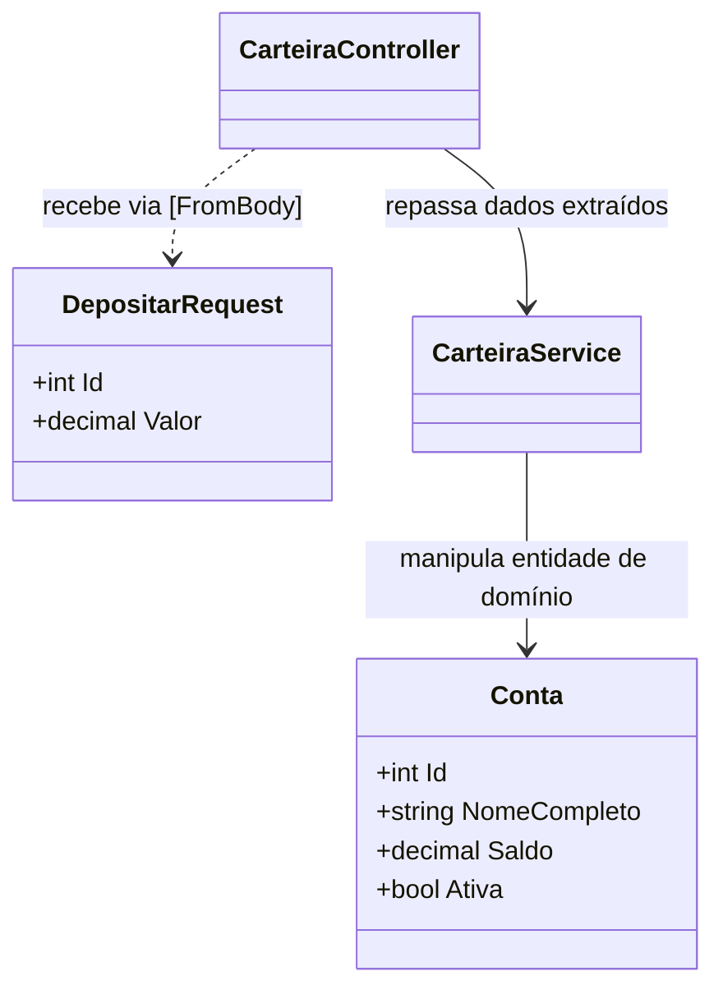
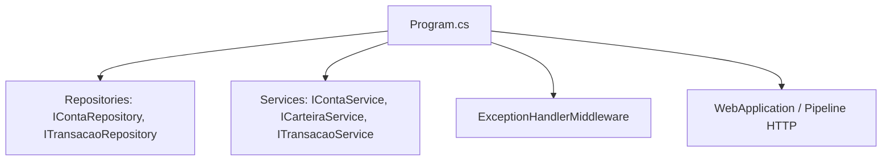

# Padrões de Projeto Já Aplicados no Projeto

Este documento mapeia os padrões de projeto que já estão presentes no código atual da API.

## 1. Repository Pattern

### Como funciona
O Repository cria uma fronteira explícita entre a regra de negócio e a forma como os dados são armazenados. A service nunca manipula listas, arquivos ou tabelas diretamente: ela conversa apenas com uma interface (`IContaRepository`, `ITransacaoRepository`), que descreve operações de domínio como "buscar por id" ou "atualizar". Quem implementa essa interface hoje é uma estrutura em memória, mas poderia ser um banco relacional, um NoSQL ou uma API externa, sem que a service precise mudar uma linha.

### Onde está aplicado
- `ContaRepository` e `TransacaoRepository` encapsulam o acesso aos dados.
- As services dependem de `IContaRepository` e `ITransacaoRepository`, não da estrutura de armazenamento.

### Evidências no código
- Contratos: `Repositories/Interfaces/IContaRepository.cs`, `Repositories/Interfaces/ITransacaoRepository.cs`.
- Implementações: `Repositories/ContaRepository.cs`, `Repositories/TransacaoRepository.cs`.
- Uso nas services: `Services/ContaService.cs`, `Services/CarteiraService.cs`, `Services/TransacaoService.cs`.

### Diagrama

### Benefício
- Isola persistência da regra de negócio.
- Facilita troca de armazenamento (in-memory para banco relacional, por exemplo).
- Melhora testabilidade via mocks das interfaces.

---

## 2. Dependency Injection (DI)

### Como funciona
Em vez de cada classe criar (`new`) suas próprias dependências, elas são recebidas prontas pelo construtor. Quem monta esse quebra-cabeça é o container de DI do ASP.NET Core: ele lê os registros feitos em `Program.cs` (`AddSingleton`, `AddScoped`) e, a cada requisição, resolve automaticamente qual implementação concreta deve ser entregue para cada interface solicitada.

### Onde está aplicado
- Controllers e services recebem dependências por construtor.
- O container do ASP.NET Core injeta automaticamente as implementações registradas.

### Evidências no código
- Registro no container: `Program.cs` com `AddSingleton` e `AddScoped`.
- Injeção por construtor: `ContaController`, `CarteiraController`, `ContaService`, `CarteiraService`, `TransacaoService`.

### Diagrama

### Benefício
- Reduz acoplamento entre classes.
- Permite substituir implementações sem alterar consumidores.
- Simplifica testes unitários.

---

## 3. Dependency Inversion (DIP como padrão arquitetural)

### Como funciona
O princípio da inversão de dependência diz que módulos de alto nível (regras de negócio) não devem depender de módulos de baixo nível (detalhes de infraestrutura); ambos devem depender de abstrações. Aqui isso é visível porque `CarteiraService` nunca conhece `ContaRepository` diretamente — ele só enxerga `IContaRepository`. Quem decide qual implementação concreta será usada é o `Program.cs`, isoladamente, no momento da composição da aplicação.

### Onde está aplicado
- Camadas de alto nível (services) dependem de abstrações (`IContaRepository`, `ITransacaoRepository`).
- `Program.cs` faz o binding de abstração para implementação concreta.

### Evidências no código
- Services tipadas por interface de repositório.
- Composição centralizada em `Program.cs`.

### Diagrama

### Benefício
- Mantém o domínio menos dependente de detalhes técnicos.
- Torna a evolução da infraestrutura menos invasiva.

---

## 4. Service Layer Pattern

### Como funciona
A camada de service concentra toda a lógica de negócio (validações, cálculos, orquestração entre repositórios), enquanto os controllers ficam responsáveis apenas por traduzir HTTP em chamadas de método. Isso significa que `CarteiraController.Depositar` não sabe como o depósito é validado ou persistido; ele apenas delega para `CarteiraService.Depositar` e devolve a resposta.

### Onde está aplicado
- `ContaService`, `CarteiraService` e `TransacaoService` centralizam regras de negócio e coordenação de operações.
- Controllers atuam como camada fina de entrada HTTP.

### Evidências no código
- Regras de negócio em `Services/CarteiraService.cs` (depósito, saque, transferência).
- Fluxo de conta em `Services/ContaService.cs` (criação, atualização, desativação).

### Diagrama

### Benefício
- Separa regras de negócio da camada web.
- Evita duplicação de regra entre endpoints.
- Melhora reuso e clareza de responsabilidades.

---

## 5. Middleware / Pipeline Pattern

### Como funciona
Toda requisição HTTP passa por uma cadeia de componentes antes de chegar ao controller. O `ExceptionHandlerMiddleware` se posiciona nessa cadeia envolvendo a chamada ao próximo passo (`_next(context)`) em um `try/catch`: se uma exceção de domínio for lançada em qualquer ponto downstream (controller, service, repository), o middleware a intercepta e converte em uma resposta HTTP padronizada, sem que cada controller precise tratar isso individualmente.

### Onde está aplicado
- `ExceptionHandlerMiddleware` intercepta exceções de domínio e traduz para respostas HTTP.
- É encadeado no pipeline de requisição do ASP.NET Core.

### Evidências no código
- Classe: `Middleware/ExceptionHandlerMiddleware.cs`.
- Registro no pipeline: `app.UseMiddleware<ExceptionHandlerMiddleware>()` em `Program.cs`.

### Diagrama

### Benefício
- Tratamento de erro centralizado.
- Evita repetição de `try/catch` em controllers.
- Garante padronização nas respostas de erro.

---

## 6. MVC (Web API com Controllers)

### Como funciona
O ASP.NET Core usa roteamento por atributo (`[Route]`, `[HttpGet]`, `[HttpPost]`...) para mapear URLs e verbos HTTP diretamente a métodos de controller. Não há Views nesta API (é uma Web API pura), mas o papel de "Controller" se mantém: receber a requisição, validar o formato de entrada e delegar para a camada de serviço, devolvendo o "Model" (dados) serializado como JSON.

### Onde está aplicado
- Endpoints organizados em controllers com roteamento por atributo.
- Requests entram via métodos anotados com `HttpGet`, `HttpPost`, `HttpPut`, `HttpDelete`.

### Evidências no código
- `Controllers/ContaController.cs`.
- `Controllers/CarteiraController.cs`.

### Diagrama

### Benefício
- Estrutura conhecida e padronizada no ecossistema ASP.NET.
- Boa separação entre transporte HTTP e regra de negócio.

---

## 7. DTO Pattern (Data Transfer Object)

### Como funciona
O payload que chega no corpo da requisição (`DepositarRequest`, `TransferirRequest`, etc.) é um objeto simples dedicado a transporte, diferente da entidade de domínio (`Conta`, `Transacao`). Isso permite que o contrato HTTP mude (adicionar/remover campo, renomear) sem impactar diretamente o modelo interno, e vice-versa.

### Onde está aplicado
- Objetos de entrada ficam em `Controllers/requests` (`CriarCarteiraRequest`, `DepositarRequest`, etc.).
- Esses objetos representam contrato de transporte, não entidades de domínio.

### Evidências no código
- Pasta `Controllers/requests/`.
- Uso de DTOs nos parâmetros `[FromBody]` dos controllers.

### Diagrama

### Benefício
- Evita acoplamento direto entre entidade de domínio e payload HTTP.
- Facilita versionamento e evolução da API.

---

## 8. Composition Root

### Como funciona
Existe um único ponto no sistema onde todas as dependências são registradas e conectadas: o `Program.cs`. Nenhuma outra classe decide qual implementação usar para uma interface — isso evita registros de DI espalhados pelo código e torna simples enxergar, em um único arquivo, como a aplicação inteira é montada.

### Onde está aplicado
- `Program.cs` centraliza criação da aplicação e configuração das dependências.

### Evidências no código
- Registro de serviços, repositórios e middleware em um único ponto.

### Diagrama

### Benefício
- Facilita manutenção da configuração.
- Deixa explícito como a aplicação é montada em runtime.

---

## Observação Importante

Nem toda boa prática é um padrão GoF clássico. Neste projeto, os padrões mais evidentes são arquiteturais e de aplicação (Repository, Service Layer, DI, Middleware, MVC e DTO), o que já representa uma base sólida para evoluções futuras.