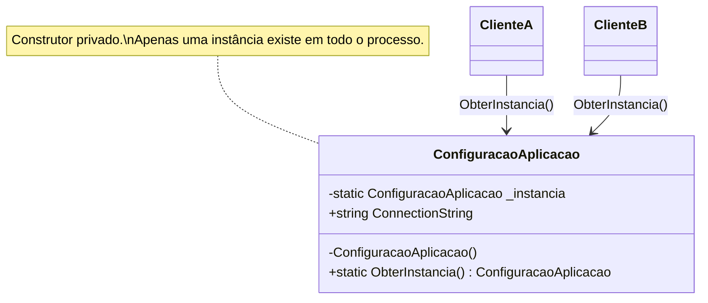
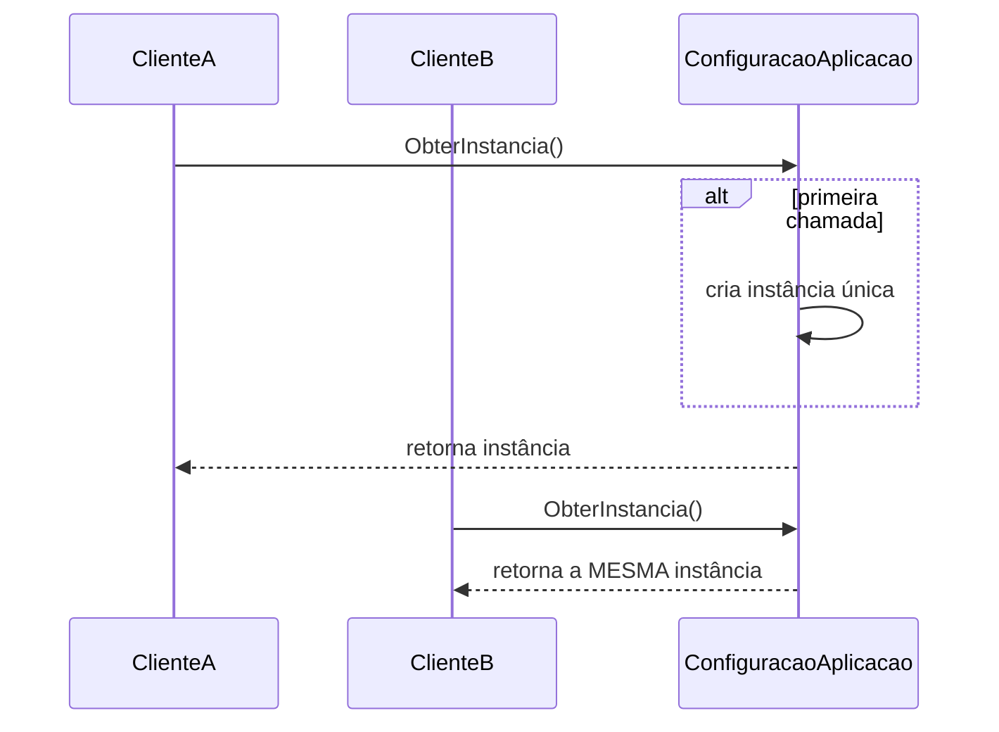
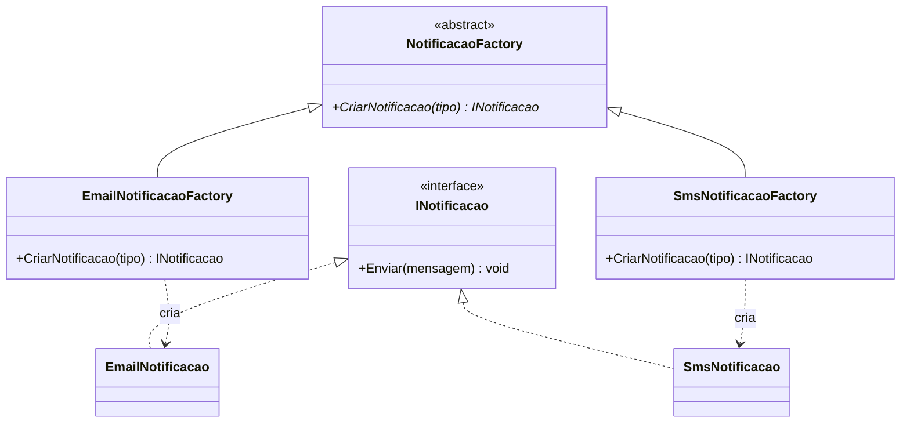
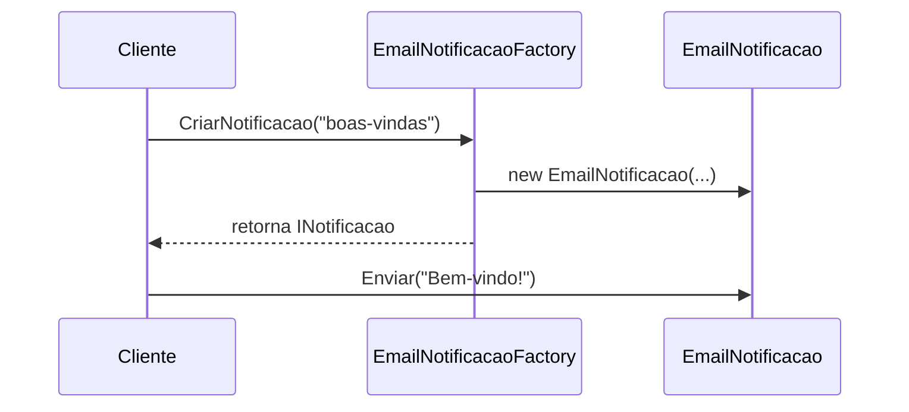
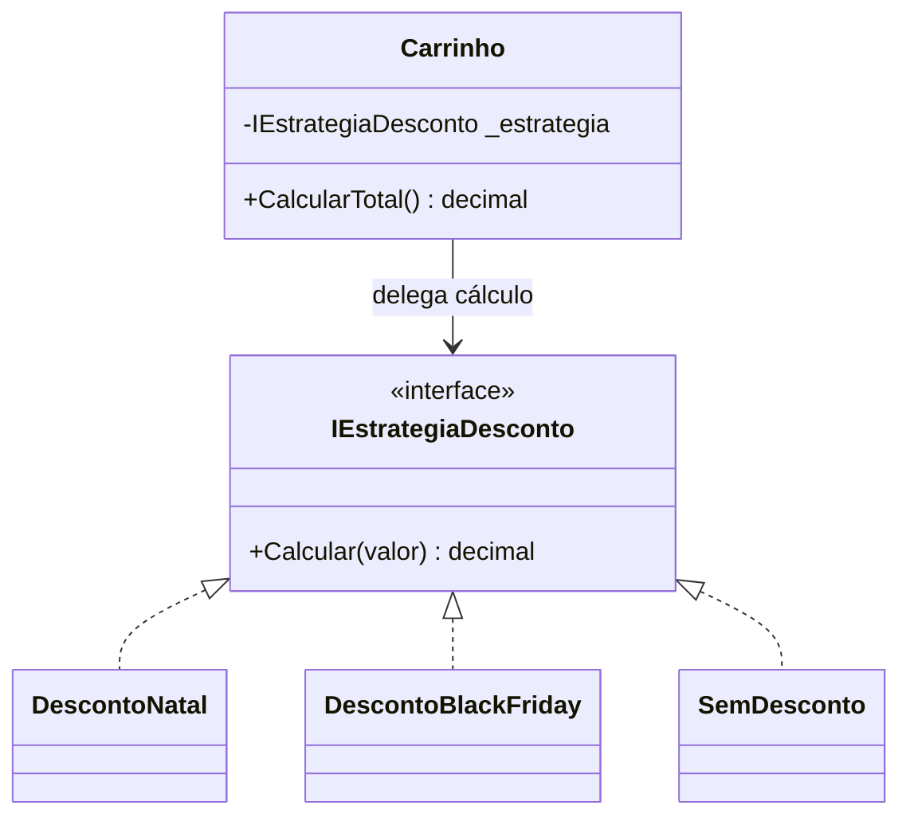
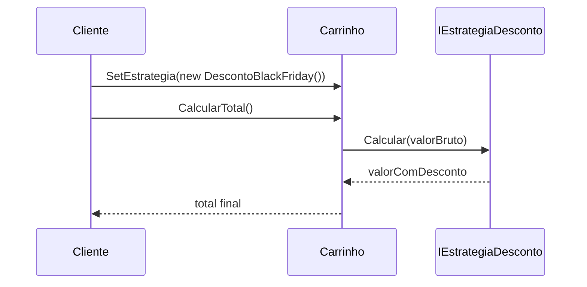
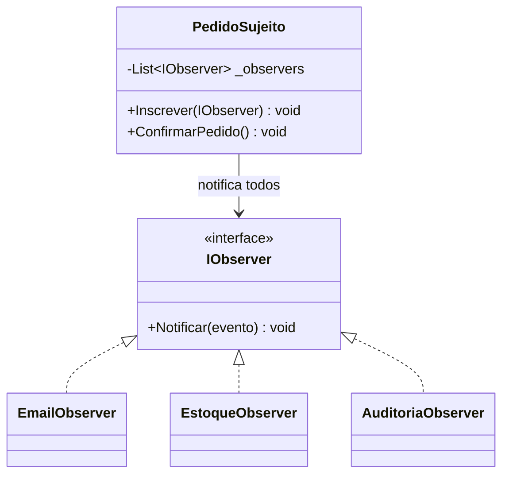
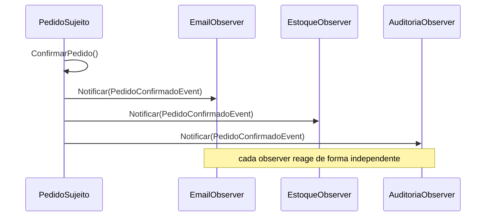
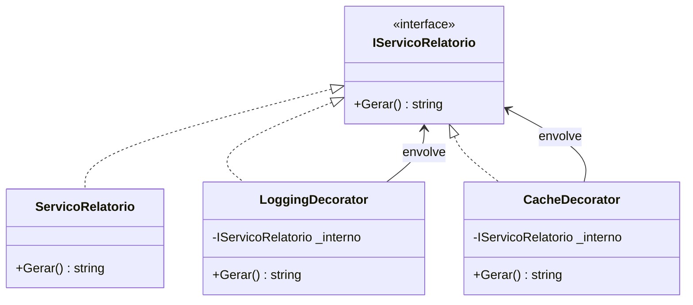
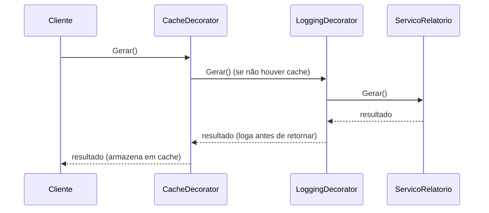

# 5 Padrões de Projeto Mais Comuns no Mercado

Este documento apresenta, de forma independente do código deste projeto, cinco dos padrões de projeto (GoF) mais citados e utilizados no mercado de software. Cada um traz explicação, quando usar, prós/contras e um diagrama em Mermaid.

Para os padrões já aplicados nesta API, veja [PADROES_PROJETO_ATUAIS.md](PADROES_PROJETO_ATUAIS.md). Para recomendações de evolução, veja [PADROES_PROJETO_PROXIMOS_PASSOS.md](PADROES_PROJETO_PROXIMOS_PASSOS.md).

---

## 1. Singleton (Criacional)

### O que é
Garante que uma classe tenha **uma única instância** em toda a aplicação e fornece um ponto global de acesso a ela.

### Quando usar
- Quando um recurso deve ser compartilhado e coordenado globalmente (ex.: configuração da aplicação, pool de conexões, cache em memória, logger).
- Quando criar múltiplas instâncias geraria custo desnecessário ou inconsistência de estado.

### Cuidados
- Usado em excesso, vira um "estado global disfarçado", dificultando testes (é preciso resetar estado entre testes) e escondendo dependências.
- Em aplicações com DI (como ASP.NET Core), o mesmo efeito costuma ser obtido de forma mais testável registrando a dependência como `Singleton` no container, em vez de implementar o padrão manualmente.

### Diagrama

---

## 2. Factory Method (Criacional)

### O que é
Define uma interface (ou método) para criar um objeto, mas deixa que as subclasses ou implementações decidam **qual classe concreta instanciar**. Evita espalhar `new` pelo código quando a criação envolve decisão ou variação.

### Quando usar
- Quando o tipo exato do objeto a ser criado só é conhecido em tempo de execução (ex.: tipo de documento, tipo de notificação, tipo de pagamento).
- Quando a lógica de construção é complexa ou repetida em vários lugares e precisa ficar centralizada.

### Cuidados
- Se há apenas uma variação simples, um Factory Method pode ser overengineering — às vezes um construtor ou método estático simples resolve.

### Diagrama

---

## 3. Strategy (Comportamental)

### O que é
Define uma família de algoritmos intercambiáveis, encapsula cada um em uma classe própria e permite trocar o algoritmo usado em tempo de execução sem alterar o código cliente.

### Quando usar
- Quando existem várias formas de realizar a mesma operação (ex.: cálculo de frete, forma de pagamento, regra de desconto) e a escolha depende de contexto/configuração.
- Quando um método está cheio de `if/else` ou `switch` decidindo "como fazer algo".

### Cuidados
- Precisa de um mecanismo para selecionar a estratégia certa (configuração, factory, parâmetro); sem isso, só desloca a complexidade.

### Diagrama

---

## 4. Observer (Comportamental)

### O que é
Define uma dependência um-para-muitos entre objetos: quando um objeto (o "sujeito"/publisher) muda de estado ou dispara um evento, todos os seus dependentes (observers/subscribers) são notificados automaticamente, sem que o sujeito precise conhecê-los em detalhe.

### Quando usar
- Quando uma ação precisa disparar múltiplos efeitos colaterais independentes (ex.: enviar e-mail, atualizar cache, registrar auditoria, notificar métricas) sem acoplar tudo isso ao fluxo principal.
- Base de arquiteturas orientadas a eventos e de "domain events".

### Cuidados
- Cadeias de eventos muito longas podem dificultar rastrear "o que dispara o quê"; é importante ter boa observabilidade/logging.

### Diagrama

---

## 5. Decorator (Estrutural)

### O que é
Permite **adicionar comportamento a um objeto dinamicamente**, envolvendo-o em uma ou mais camadas (decorators) que implementam a mesma interface do objeto original. O cliente continua chamando a mesma interface, sem saber quantas camadas existem por trás.

### Quando usar
- Para adicionar preocupações transversais (logging, cache, métricas, retry, compressão) sem alterar a classe original nem criar uma explosão de subclasses para cada combinação.
- Quando o comportamento adicional precisa poder ser ligado/desligado por composição, em vez de herança fixa.

### Cuidados
- Excesso de camadas de decorator pode dificultar debugar o fluxo real de execução.

### Diagrama

---

## Resumo comparativo

| Padrão | Categoria | Problema que resolve | Palavra-chave |
|---|---|---|---|
| Singleton | Criacional | Garantir instância única e acesso global | "uma só instância" |
| Factory Method | Criacional | Centralizar/abstrair a criação de objetos variáveis | "quem cria decide o tipo" |
| Strategy | Comportamental | Trocar algoritmo/regra em tempo de execução | "várias formas de fazer" |
| Observer | Comportamental | Notificar múltiplos interessados sobre um evento | "um evento, vários reagem" |
| Decorator | Estrutural | Adicionar comportamento sem alterar a classe original | "empacotar camadas" |

Vale notar que Strategy, Observer e Decorator já aparecem como recomendações de evolução para esta API em [PADROES_PROJETO_PROXIMOS_PASSOS.md](PADROES_PROJETO_PROXIMOS_PASSOS.md), o que reforça por que são tão comuns no mercado: resolvem problemas recorrentes em qualquer domínio de negócio.
