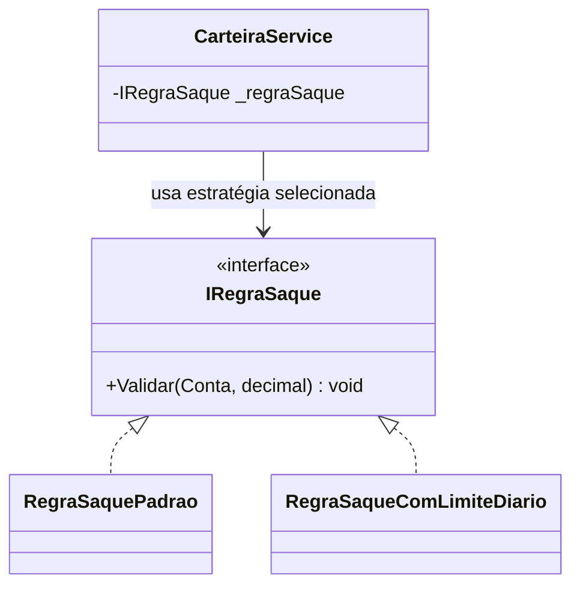
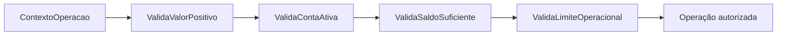
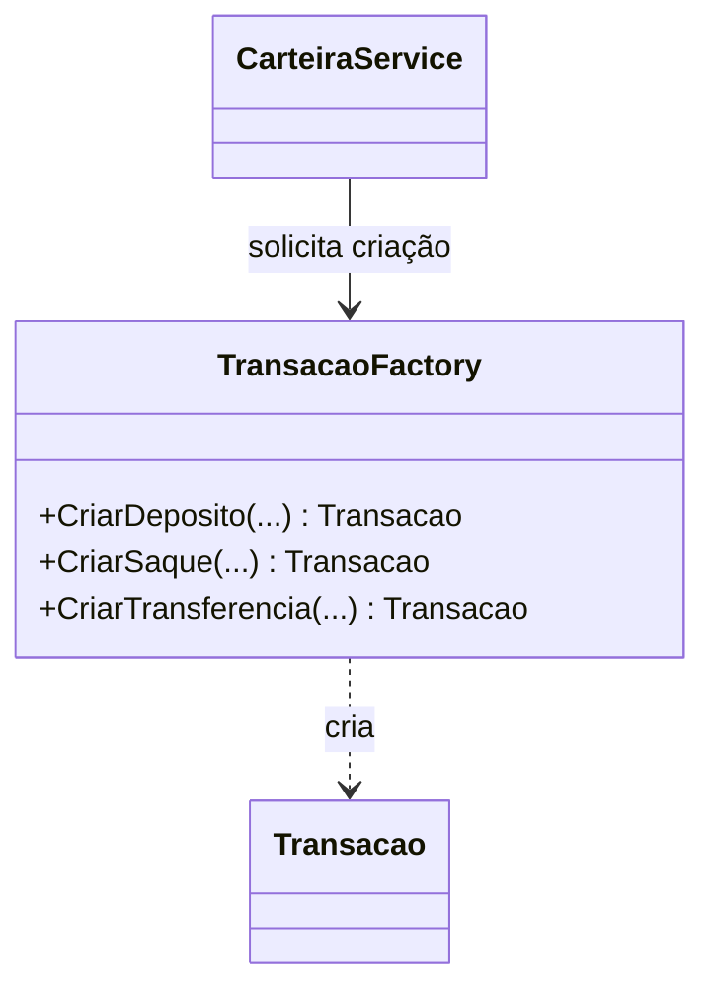
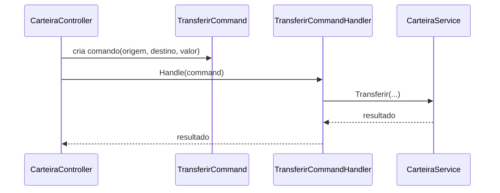
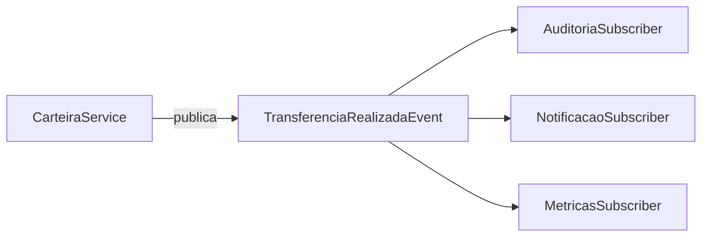
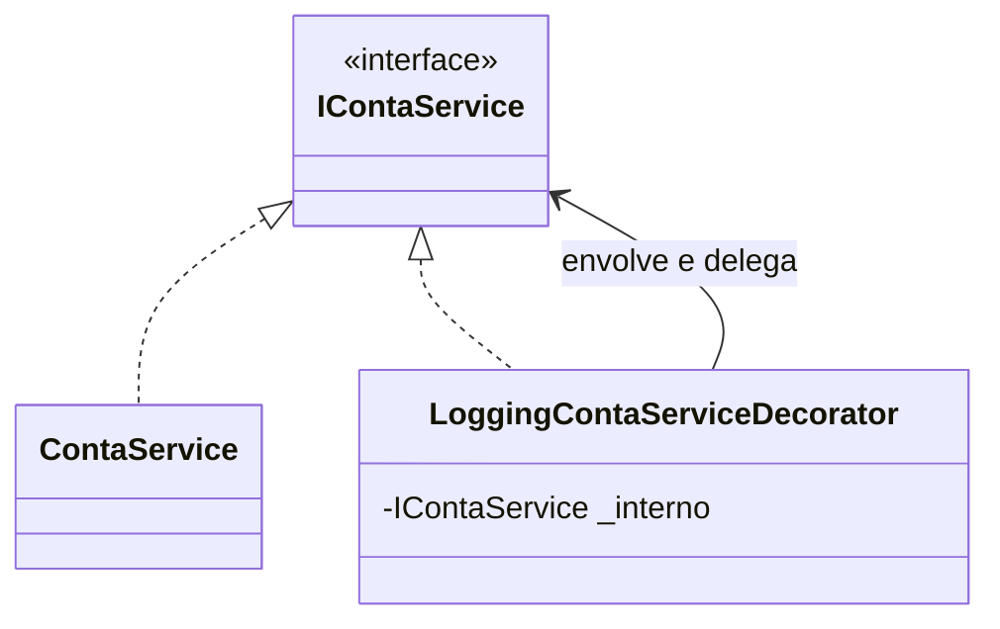
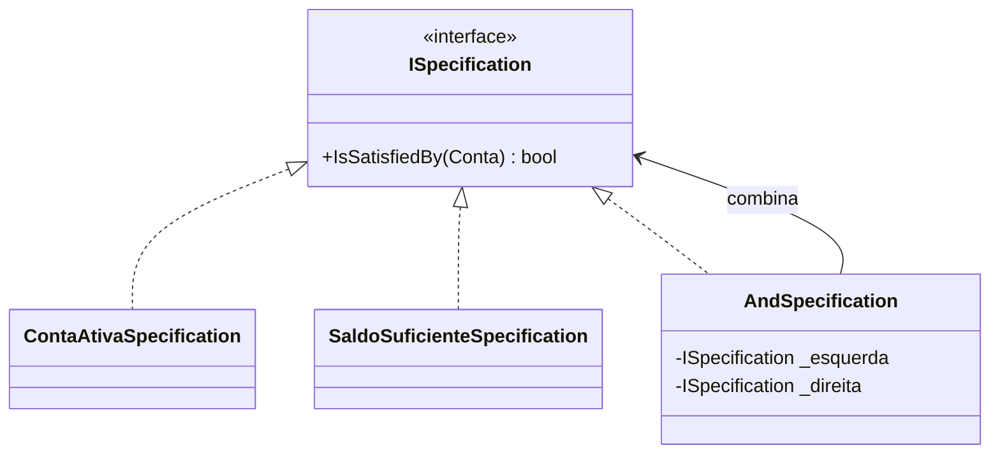
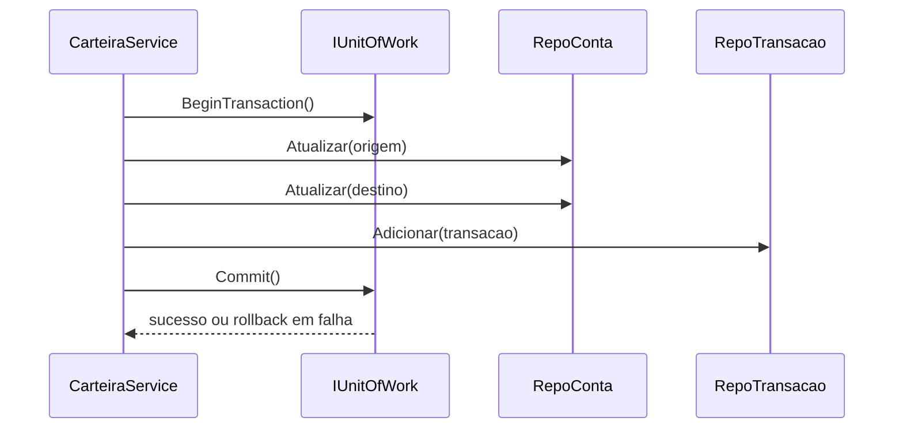
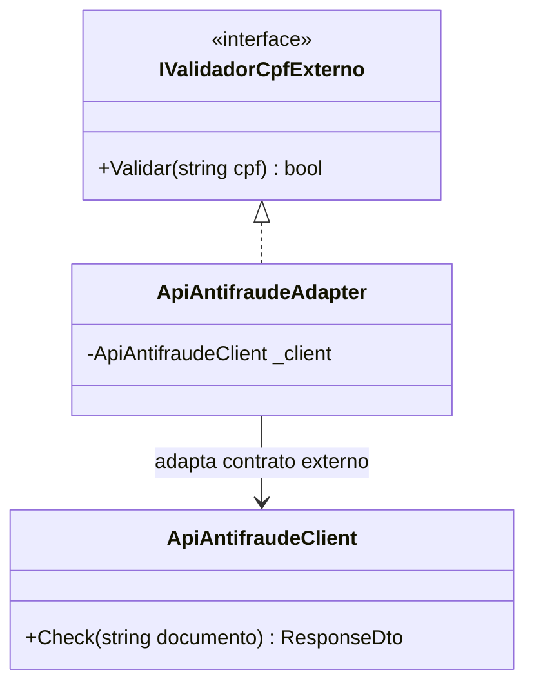

# Padrões de Projeto: Introdução e Próximos Passos

Este documento complementa [PADROES_PROJETO_ATUAIS.md](PADROES_PROJETO_ATUAIS.md) com:

- uma visão geral dos tipos de padrões de projeto;
- os padrões mais conhecidos do mercado (além dos já aplicados);
- recomendações de padrões que fazem sentido para a evolução desta API.

## 1. Introdução: o que são padrões de projeto

Padrões de projeto são soluções reutilizáveis para problemas recorrentes de design de software.
Eles não são "receitas prontas", mas guias para tomar decisões arquiteturais com menor risco.

Em geral, ajudam a:

- reduzir acoplamento;
- melhorar legibilidade e manutenção;
- facilitar testes;
- permitir evolução incremental do sistema.

## 2. Tipos de padrões de projeto

### 2.1 Criacionais

Focam em como objetos são criados.

Exemplos famosos:

- Singleton
- Factory Method
- Abstract Factory
- Builder
- Prototype

Quando usar: quando o processo de criação é complexo, varia por contexto ou não deve ficar espalhado no código.

### 2.2 Estruturais

Focam em como classes e objetos são compostos.

Exemplos famosos:

- Adapter
- Facade
- Decorator
- Proxy
- Composite
- Bridge

Quando usar: quando é preciso integrar componentes, simplificar APIs internas ou adicionar comportamento sem alterar a classe original.

### 2.3 Comportamentais

Focam em colaboração e distribuição de responsabilidades.

Exemplos famosos:

- Strategy
- Observer
- Command
- Chain of Responsibility
- Template Method
- State
- Mediator
- Visitor
- Memento
- Interpreter
- Iterator

Quando usar: quando regras variam no tempo, fluxos crescem e decisões condicionais ficam difíceis de manter.

### 2.4 Arquiteturais e de aplicação (não GoF)

Além dos GoF, sistemas modernos usam padrões de aplicação muito relevantes.

Exemplos famosos:

- Layered Architecture
- Hexagonal (Ports and Adapters)
- Clean Architecture
- CQRS
- Event-Driven Architecture
- Unit of Work
- Repository
- Service Layer

Quando usar: quando o objetivo é evoluir limites de camadas, testabilidade e governança da arquitetura.

## 3. Padrões famosos além dos já adotados neste projeto

Como o projeto já aplica Repository, DI, Service Layer, Middleware, MVC, DTO e Composition Root, os próximos padrões mais conhecidos que costumam aparecer em APIs desse tipo são:

- Factory Method / Abstract Factory
- Builder
- Strategy
- Chain of Responsibility
- Command
- Observer (eventos de domínio)
- Decorator
- Facade
- Adapter
- Unit of Work
- Specification
- CQRS (em nível de aplicação)

## 4. Padrões que fazem sentido aplicar nesta API

Abaixo estão os padrões com maior aderência ao cenário atual de conta, carteira e transação.

## 4.1 Strategy para regras financeiras variáveis

### Problema atual
As regras de saque, depósito e transferência tendem a crescer (limite diário, tarifa, horário, perfil da conta).

### Aplicação sugerida
Criar interfaces de estratégia para regras variáveis, por exemplo:

- `IRegraSaque`
- `IRegraTransferencia`
- `IRegraDeposito`

Cada estratégia implementa uma variação de regra e pode ser selecionada por contexto.

### Diagrama

### Benefício
- reduz `if/else` extensos;
- facilita extensão sem alterar fluxos centrais;
- melhora testes por cenário.

## 4.2 Chain of Responsibility para pipeline de validações

### Problema atual
Validações tendem a se acumular na service/caso de uso.

### Aplicação sugerida
Criar um pipeline de validações para cada operação:

- valida valor positivo;
- valida conta ativa;
- valida saldo suficiente;
- valida limite operacional.

Cada etapa recebe um contexto e passa para o próximo validador.

### Diagrama

### Benefício
- separa responsabilidades de validação;
- permite reuso de etapas entre operações;
- reduz acoplamento entre regras.

## 4.3 Factory Method para criação de Transacao

### Problema atual
A criação de objetos `Transacao` pode crescer com regras de inicialização por tipo.

### Aplicação sugerida
Encapsular criação em fábricas, por exemplo:

- `TransacaoFactory.CriarDeposito(...)`
- `TransacaoFactory.CriarSaque(...)`
- `TransacaoFactory.CriarTransferencia(...)`

### Diagrama

### Benefício
- centraliza regras de construção;
- evita duplicação de inicialização;
- melhora consistência dos objetos gerados.

## 4.4 Command para operações transacionais

### Problema atual
A service pode ficar inchada ao orquestrar ações complexas.

### Aplicação sugerida
Representar cada operação como comando:

- `DepositarCommand`
- `SacarCommand`
- `TransferirCommand`

Com handlers dedicados:

- `DepositarCommandHandler`
- `TransferirCommandHandler`

### Diagrama

### Benefício
- separa intenção da execução;
- facilita logging, auditoria e testes;
- prepara terreno para filas/processamento assíncrono no futuro.

## 4.5 Observer (Domain Events) para auditoria e integrações

### Problema atual
Ações secundárias (auditoria, notificação, métricas) podem acoplar ao fluxo principal.

### Aplicação sugerida
Publicar eventos de domínio:

- `ContaCriadaEvent`
- `TransferenciaRealizadaEvent`
- `SaqueRealizadoEvent`

Assinantes tratam efeitos colaterais sem poluir a regra principal.

### Diagrama

### Benefício
- desacopla fluxo principal de efeitos colaterais;
- facilita evolução para integração com mensageria;
- melhora observabilidade.

## 4.6 Decorator para cross-cutting concerns

### Problema atual
Preocupações transversais (log, métricas, cache) podem invadir classes de negócio.

### Aplicação sugerida
Criar decorators para interfaces de service:

- `LoggingContaServiceDecorator`
- `MetricasCarteiraServiceDecorator`

### Diagrama

### Benefício
- adiciona comportamento sem alterar implementação original;
- preserva responsabilidade das services;
- facilita ativar/desativar comportamentos por configuração.

## 4.7 Specification para regras de elegibilidade

### Problema atual
Regras de elegibilidade podem virar condicionais espalhadas.

### Aplicação sugerida
Modelar regras como especificações combináveis:

- `ContaAtivaSpecification`
- `SaldoSuficienteSpecification`
- `ValorPositivoSpecification`

Composição por `And`, `Or`, `Not`.

### Diagrama

### Benefício
- regras expressivas e reutilizáveis;
- menor duplicação de lógica;
- leitura mais próxima da linguagem de negócio.

## 4.8 Unit of Work ao migrar para banco relacional

### Problema atual
No in-memory atual o commit é implícito, mas em banco real transferências exigirão atomicidade.

### Aplicação sugerida
Introduzir `IUnitOfWork` para coordenar transações de persistência entre múltiplos repositórios.

### Diagrama

### Benefício
- garante consistência em operações multi-entidade;
- evita estado parcial em falhas;
- melhora governança transacional.

## 4.9 Adapter para integração externa

### Problema atual
No futuro, validações de CPF, antifraude ou notificação podem depender de APIs terceiras com contratos diferentes.

### Aplicação sugerida
Criar adapters para padronizar integrações externas atrás de interfaces internas.

### Diagrama

### Benefício
- protege domínio de contratos voláteis externos;
- reduz impacto de troca de fornecedor;
- facilita testes com doubles da interface interna.

## 5. Priorização recomendada para evolução

Ordem sugerida para maximizar ganho com menor risco:

1. Factory Method para criação de transações.
2. Chain of Responsibility para validações.
3. Strategy para regras financeiras variáveis.
4. Observer para auditoria/eventos.
5. Decorator para logging e métricas.
6. Unit of Work quando houver migração para banco relacional.

## 6. Guia rápido de adoção responsável

Para evitar overengineering:

- aplicar padrão somente quando houver dor real recorrente;
- começar simples e evoluir por necessidade;
- incluir testes antes e depois da mudança;
- medir impacto em complexidade cognitiva do time.

Padrão de projeto deve simplificar o sistema ao longo do tempo, não apenas "deixar bonito" no diagrama.