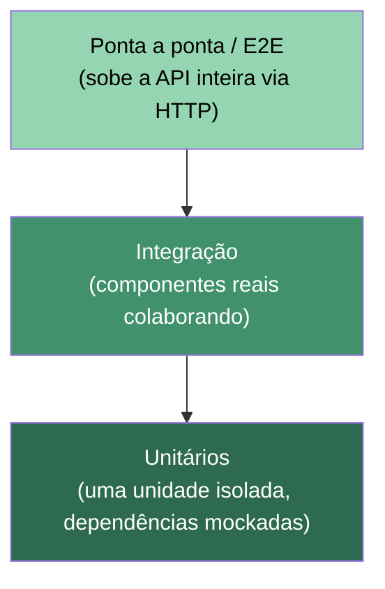

# Código Testável, Testes e Escalabilidade

Este documento explica, com exemplos já aplicados neste repositório, como a aplicação foi
estruturada para ser **testável**, por que os testes existentes importam, como eles estão
**organizados para facilitar manutenção futura** e como essas escolhas ajudam na
**escalabilidade** da aplicação (tanto em código quanto em time).

---

## 1. Camadas de teste

Testes automatizados costumam ser pensados em camadas — cada uma com um custo de
manutenção/execução e um nível de confiança diferentes. Quanto mais alto na pirâmide,
mais lento e mais caro o teste tende a ser; por isso a base deve ser a maior parte da
suíte.



### 1.1 Testes unitários (a maioria da nossa suíte)

Testam **uma unidade isolada** (um método, uma classe), substituindo suas dependências por
dublês (mocks/stubs). São rápidos (a suíte inteira roda em ~50ms) e são a maior parte dos
testes deste projeto.

- **Services com Moq**: [CarteiraServiceTests.cs](Course.Api.Tests/Services/CarteiraServiceTests.cs)
  isola `CarteiraService` mockando `IContaRepository` e `ITransacaoRepository`, testando só
  a regra de negócio (saldo, exceções), sem depender de uma implementação real de repositório:

  ```csharp
  private readonly Mock<IContaRepository> _contaRepoMock = new();
  private readonly Mock<ITransacaoRepository> _transacaoRepoMock = new();
  private readonly CarteiraService _service;

  public CarteiraServiceTests()
  {
      _service = new CarteiraService(_contaRepoMock.Object, _transacaoRepoMock.Object, NullLogger<CarteiraService>.Instance);
  }
  ```

- **Middleware sem subir a aplicação**: [ExceptionHandlerMiddlewareTests.cs](Course.Api.Tests/Middleware/ExceptionHandlerMiddlewareTests.cs)
  testa `ExceptionHandlerMiddleware` construindo um `DefaultHttpContext` na mão e chamando
  `InvokeAsync` diretamente — não precisa de servidor HTTP nem de `WebApplicationFactory`:

  ```csharp
  var middleware = new ExceptionHandlerMiddleware(next, NullLogger<ExceptionHandlerMiddleware>.Instance);
  var context = new DefaultHttpContext();
  context.Response.Body = new MemoryStream();

  await middleware.InvokeAsync(context);
  ```

- **Validação de dados isolada da API**: [RequestValidationTests.cs](Course.Api.Tests/Controllers/Requests/RequestValidationTests.cs)
  testa os `[Required]`, `[EmailAddress]`, `[Range]` etc. dos DTOs de request usando
  `Validator.TryValidateObject`, sem precisar de uma requisição HTTP real:

  ```csharp
  var contexto = new ValidationContext(request);
  var resultados = new List<ValidationResult>();
  Validator.TryValidateObject(request, contexto, resultados, validateAllProperties: true);
  ```

### 1.2 Testes de integração

Testam **dois ou mais componentes reais colaborando**, sem dublês. Aqui não existe
banco de dados externo — o "repositório real" é a implementação em memória — então os
testes de repositório já funcionam como testes de integração entre a classe e sua estrutura
de armazenamento interna:

- [ContaRepositoryTests.cs](Course.Api.Tests/Repositories/ContaRepositoryTests.cs) e
  [TransacaoRepositoryTests.cs](Course.Api.Tests/Repositories/TransacaoRepositoryTests.cs)
  instanciam `ContaRepository`/`TransacaoRepository` **de verdade** (sem mock) e verificam
  o comportamento real de `Adicionar`, `BuscarPorId`, geração de IDs sequenciais etc.:

  ```csharp
  private readonly ContaRepository _repository = new();

  [Fact]
  public void Adicionar_MultiplasContas_IdsSequenciais()
  {
      var c1 = _repository.Adicionar(ContaBase("111.111.111-11"));
      var c2 = _repository.Adicionar(ContaBase("222.222.222-22"));

      Assert.Equal(1, c1.Id);
      Assert.Equal(2, c2.Id);
  }
  ```

### 1.3 Testes ponta a ponta (E2E) — lacuna atual

Hoje **não existe** esse nível na suíte: nenhum teste sobe a API completa (`Program.cs`,
DI container, middlewares e roteamento juntos) e faz uma chamada HTTP real, como os cURLs
descritos em [API_CURLS.md](API_CURLS.md). Isso poderia ser feito com
`Microsoft.AspNetCore.Mvc.Testing` (`WebApplicationFactory<Program>`), simulando exatamente
o que um cliente HTTP faz — é o próximo passo natural de evolução da suíte.

---

## 2. O que torna o código testável

Um código só é fácil de testar quando ele é fácil de **isolar**. Este projeto aplica alguns
princípios para isso:

### 2.1 Programar contra interfaces, não implementações

Cada camada depende de **interfaces**, não de classes concretas:

```csharp
public class CarteiraService : ICarteiraService
{
    private readonly IContaRepository _contaRepository;
    private readonly ITransacaoRepository _transacaoRepository;
    private readonly ILogger<CarteiraService> _logger;

    public CarteiraService(IContaRepository contaRepository, ITransacaoRepository transacaoRepository, ILogger<CarteiraService> logger)
    {
        _contaRepository = contaRepository;
        _transacaoRepository = transacaoRepository;
        _logger = logger;
    }
```

Veja [ICarteiraService.cs](Course.Api/Services/Interfaces/ICarteiraService.cs) e
[IContaRepository.cs](Course.Api/Repositories/Interfaces/IContaRepository.cs). Como o
`CarteiraService` só conhece a **abstração** (`IContaRepository`), o teste pode trocar a
implementação real por um `Mock<IContaRepository>` sem tocar em nenhuma linha de produção.

### 2.2 Injeção de dependência via construtor

Todas as dependências chegam pelo construtor (nunca são criadas com `new` dentro da classe)
e são registradas centralmente em [Program.cs](Course.Api/Program.cs):

```csharp
builder.Services.AddSingleton<IContaRepository, ContaRepository>();
builder.Services.AddSingleton<ITransacaoRepository, TransacaoRepository>();
builder.Services.AddScoped<IContaService, ContaService>();
builder.Services.AddScoped<ICarteiraService, CarteiraService>();
builder.Services.AddScoped<ITransacaoService, TransacaoService>();
```

Isso significa que trocar `ContaRepository` (em memória) por uma implementação com banco de
dados real no futuro não exige alterar `CarteiraService`, `ContaController` nem os testes
que usam mocks — só a linha de registro de DI muda.

### 2.3 Middlewares e regras de negócio isolados de detalhes de infraestrutura

O `ExceptionHandlerMiddleware` só depende de `RequestDelegate` e `ILogger` — nenhuma
dependência estática, nenhum acoplamento ao `Program.cs` — por isso pode ser testado
instanciando a classe diretamente com um `HttpContext` fake, sem subir um servidor real.

### 2.4 Exceções de domínio com significado próprio

As regras de negócio lançam exceções específicas (`ValorInvalidoException`,
`SaldoInsuficienteException`, `ContaInativaException`, ...) em vez de mensagens genéricas.
Isso torna as asserções de teste diretas e legíveis:

```csharp
[Theory]
[InlineData(0)]
[InlineData(-50)]
public void Depositar_ValorInvalido_LancaValorInvalidoException(decimal valor)
{
    Assert.Throws<ValorInvalidoException>(() => _service.Depositar(1, valor));
}
```

---

## 3. Importância dos testes

- **Rede de segurança para refatoração**: como `CarteiraService`, `ContaService` e o
  middleware de exceções têm testes cobrindo cenário feliz e de erro, é possível alterar a
  implementação interna (ex.: mudar como o hash de senha é calculado, em
  [ContaService.cs](Course.Api/Services/ContaService.cs)) com confiança de que qualquer
  regressão será detectada imediatamente.
- **Documentação executável**: `ExceptionHandlerMiddlewareTests` documenta, de forma que não
  fica desatualizada, exatamente qual HTTP status cada exceção gera (`ContaNaoEncontradaException`
  → 404, `DomainException` → 400, exceção não mapeada → 500 sem vazar detalhes). Um novo
  desenvolvedor entende o contrato da API lendo os testes, sem precisar rodar a aplicação.
- **Detecção precoce de regressão de segurança**: o teste
  `InvokeAsync_ExcecaoNaoMapeada_Retorna500SemVazarDetalhes` garante, via `Assert.DoesNotContain`,
  que mensagens de exceções internas nunca vazam para o cliente — se alguém remover essa
  proteção no futuro, o teste quebra imediatamente.
- **Cobertura de casos de borda esquecidos na implementação manual**: os testes de
  `RequestValidationTests` cobrem CPF malformado, senha curta, e-mail inválido, IDs `<= 0` —
  casos fáceis de esquecer testando manualmente via cURL.

---

## 4. Organização para manutenção futura

A estrutura de pastas de `Course.Api.Tests` **espelha** a estrutura de `Course.Api`, o que
facilita encontrar o teste de qualquer classe de produção:

```
Course.Api/                              Course.Api.Tests/
├── Services/CarteiraService.cs      →   ├── Services/CarteiraServiceTests.cs
├── Repositories/ContaRepository.cs  →   ├── Repositories/ContaRepositoryTests.cs
├── Middleware/ExceptionHandler...   →   ├── Middleware/ExceptionHandlerMiddlewareTests.cs
└── Controllers/requests/*.cs        →   └── Controllers/Requests/RequestValidationTests.cs
```

Outras convenções que ajudam na manutenção:

- **Nomenclatura consistente**: `MetodoTestado_Cenario_ResultadoEsperado`, por exemplo
  `Sacar_SaldoInsuficiente_LancaSaldoInsuficienteException`. Isso permite entender o que
  quebrou só olhando o nome do teste no relatório do CI, sem abrir o código.
- **Arrange-Act-Assert** em todos os testes (configura mocks → chama o método → confere o
  resultado), sempre nessa ordem e sem lógica condicional dentro do teste.
- **Builders/factories privados para massa de teste**, evitando duplicação:

  ```csharp
  private static Conta ContaAtiva(int id = 1, decimal saldo = 500) => new() { ... Ativa = true };
  private static Conta ContaInativa(int id = 2) => new() { ... Ativa = false };
  ```

  Se o modelo `Conta` ganhar um novo campo obrigatório amanhã, só esses métodos precisam ser
  atualizados — não cada teste individualmente.
- **`[Theory]` + `[InlineData]` para variações do mesmo cenário** (ex.: vários valores
  inválidos de saque/depósito), reduzindo duplicação de métodos de teste quase idênticos.
- **Um teste, uma responsabilidade**: cada `[Fact]` valida uma única regra (ex.: só o status
  code, ou só a mensagem), o que torna a causa de uma falha óbvia.

---

## 5. Escalabilidade da aplicação

"Escalabilidade" aqui vale tanto para o **código crescer sem virar um problema** quanto para
o **time crescer sem pisar no trabalho um do outro**:

- **Trocar implementações sem quebrar contratos**: como `ContaService` e `CarteiraService`
  dependem de `IContaRepository`/`ITransacaoRepository`, o repositório em memória atual pode
  ser substituído por um repositório com Entity Framework/SQL/Redis sem alterar a camada de
  serviço, os controllers, nem os testes unitários existentes (só os testes de integração do
  novo repositório mudam).
- **Times trabalhando em paralelo**: a separação em `Controllers` → `Services` → `Repositories`
  (documentada em [SEPARACAO_RESPONSABILIDADES_CONTROLLER_SERVICE_REPOSITORY.md](SEPARACAO_RESPONSABILIDADES_CONTROLLER_SERVICE_REPOSITORY.md))
  combinada com testes por camada permite que uma pessoa mexa em `TransacaoService` enquanto
  outra mexe em `ExceptionHandlerMiddleware`, cada uma com sua própria suíte de testes rápida,
  sem depender de coordenar mudanças no mesmo arquivo.
- **Crescimento incremental sem medo**: novas regras de negócio (ex.: um novo tipo de
  transação) seguem o mesmo molde — nova exceção em
  [DomainException.cs](Course.Api/Exceptions/DomainException.cs), nova validação no request,
  novos testes no mesmo padrão — em vez de exigir redesenho da arquitetura.
- **Suíte rápida o bastante para rodar sempre**: hoje a suíte inteira (76 testes) roda em
  dezenas de milissegundos porque é majoritariamente unitária. Isso permite rodá-la a cada
  `git push`/PR sem virar gargalo, o que só é sustentável enquanto a maior parte dos testes
  continuar na base da pirâmide (unitários) em vez de todos virarem testes de integração/E2E
  lentos.
- **Observabilidade pronta para escalar em produção**: o
  [RequestLoggingMiddleware.cs](Course.Api/Middleware/RequestLoggingMiddleware.cs) e o
  endpoint `/health` registrado em [Program.cs](Course.Api/Program.cs)
  (`app.MapHealthChecks("/health")`) já preparam a aplicação para ser monitorada em múltiplas
  instâncias atrás de um load balancer.

### Próximos passos recomendados

1. Adicionar testes E2E com `WebApplicationFactory<Program>` cobrindo o fluxo HTTP completo
   (request → validação → service → resposta), complementando os cURLs manuais de
   [API_CURLS.md](API_CURLS.md).
2. Adicionar testes para o `RequestLoggingMiddleware` (hoje sem cobertura).
3. Medir cobertura de código (`coverlet`, já presente como dependência) para identificar
   lacunas antes de novas features.
